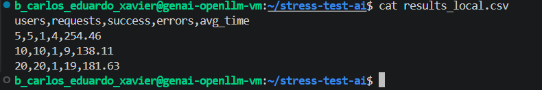
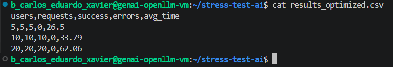
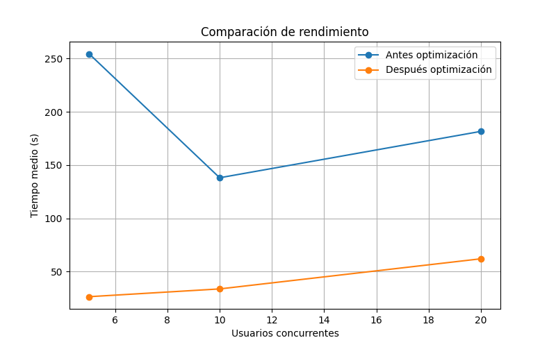

# Práctica: Pruebas de Estrés y Optimización de Modelos IA

**Autor: Carlos Eduardo Xavier**

---

# Objetivo

El objetivo de esta práctica es analizar el comportamiento de un modelo de inteligencia artificial bajo diferentes niveles de carga concurrente, identificar posibles cuellos de botella e implementar optimizaciones para mejorar el rendimiento.

Se realizaron pruebas de estrés sobre el modelo local **Gemma 4 E4B** ejecutado mediante Ollama utilizando peticiones concurrentes en Python con las librerías `asyncio` y `aiohttp`.

---

# Tecnologías utilizadas

- Python 3
- Asyncio
- Aiohttp
- Pandas
- Matplotlib
- Ollama
- Gemma 4 E4B

---

# Estructura del proyecto

```text
stress-test-ai/
│
├── stress_test.py
├── graph.py
├── results_local.csv
├── results_optimized.csv
├── performance_comparison.png
├── capturas/
│   ├── stress-execution-before.png
│   ├── stress-execution-after.png
│   └── performance-comparison.png
│
└── README.md
```

---

# Escenarios de carga

Se ejecutaron tres escenarios diferentes:

- 5 usuarios concurrentes
- 10 usuarios concurrentes
- 20 usuarios concurrentes

Cada escenario enviaba peticiones simultáneas al modelo para medir:

- Tiempo medio de respuesta
- Número de peticiones exitosas
- Número de errores

---

# Resultados iniciales (sin optimización)

| Usuarios | Requests | Correctas | Errores | Tiempo medio (s) |
|----------|----------|----------|----------|------------------|
| 5 | 5 | 1 | 4 | 254.46 |
| 10 | 10 | 1 | 9 | 138.11 |
| 20 | 20 | 1 | 19 | 181.63 |

## Evidencia



---

# Identificación de cuellos de botella

Durante las pruebas iniciales se detectaron los siguientes problemas:

- El modelo local no gestionaba correctamente múltiples peticiones concurrentes.
- A partir de 5 usuarios aparecía una gran cantidad de errores.
- El tiempo medio de respuesta era extremadamente elevado.
- El backend local se convertía rápidamente en el principal cuello de botella.

---

# Optimizaciones implementadas

## Optimización 1: Reducción del prompt

Prompt original:

```text
Explica qué es Docker en una frase.
```

Prompt optimizado:

```text
Hola
```

Esto redujo significativamente el número de tokens procesados.

---

## Optimización 2: Ajuste de parámetros del modelo

Se añadieron los siguientes parámetros:

```json
{
  "temperature": 0.2,
  "num_predict": 25
}
```

Beneficios obtenidos:

- Menor generación de tokens.
- Menor tiempo de respuesta.
- Menor carga sobre el modelo.
- Mayor estabilidad bajo concurrencia.

---

# Resultados después de la optimización

| Usuarios | Requests | Correctas | Errores | Tiempo medio (s) |
|----------|----------|----------|----------|------------------|
| 5 | 5 | 5 | 0 | 26.50 |
| 10 | 10 | 10 | 0 | 33.79 |
| 20 | 20 | 20 | 0 | 62.06 |

## Evidencia



---

# Comparativa antes vs después

## Escenario 5 usuarios

| Métrica | Antes | Después |
|----------|----------|----------|
| Correctas | 1 | 5 |
| Errores | 4 | 0 |
| Tiempo medio | 254.46 s | 26.50 s |

---

## Escenario 10 usuarios

| Métrica | Antes | Después |
|----------|----------|----------|
| Correctas | 1 | 10 |
| Errores | 9 | 0 |
| Tiempo medio | 138.11 s | 33.79 s |

---

## Escenario 20 usuarios

| Métrica | Antes | Después |
|----------|----------|----------|
| Correctas | 1 | 20 |
| Errores | 19 | 0 |
| Tiempo medio | 181.63 s | 62.06 s |

---

# Gráfica de rendimiento

La siguiente gráfica muestra la comparación entre los tiempos de respuesta antes y después de aplicar las optimizaciones.



---

# Conclusiones

Tras analizar los resultados se observó que el modelo local Gemma 4 E4B sufría una degradación importante bajo carga concurrente.

Las optimizaciones aplicadas permitieron:

- Reducir significativamente los tiempos de respuesta.
- Eliminar completamente los errores en todos los escenarios probados.
- Mantener una tasa de éxito del 100%.
- Mejorar la estabilidad general del sistema.

En conclusión, la reducción de la complejidad del prompt y el ajuste de los parámetros del modelo tuvieron un impacto muy positivo en el rendimiento del backend local.